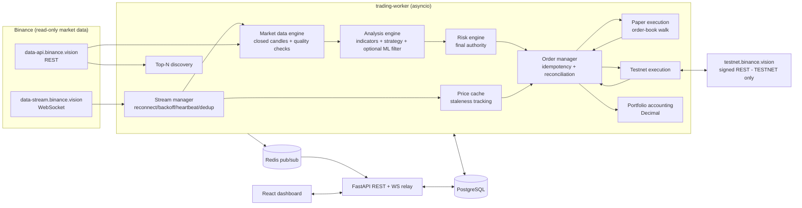

# Architecture

## Overview

## Processes

| Process | Responsibility |
|---|---|
| `backend` (FastAPI) | REST API, auth, settings, backtests, WebSocket relay to the browser. Applies migrations on start. |
| `trading-worker` | The **only** process that trades. Holds a DB lease so a second worker can never trade at the same time. |
| `postgres` | System of record: orders, fills, positions, trades, snapshots, signals, logs, settings. |
| `redis` | Event fan-out from the worker to API processes (dashboard live updates). |
| `frontend` | Static React build served by nginx; proxies `/api` and `/ws` to the backend. |

Without Docker, `RUN_WORKER_IN_API=true` runs the worker inside the API process and events use an in-process bus (no Redis needed).

The API and the worker talk only through the database:

* control state (`RUNNING`/`PAUSED`/`STOPPED`, execution mode) → `system_settings.control`
* manual close requests → `system_settings.commands.close_position`
* worker status and heartbeat → `system_settings.worker.status`

## Trading lifecycle

1. **Market data** – a WebSocket kline closes → the candle is validated and stored (unique `symbol, timeframe, open_time`).
2. **Indicators** – computed from *closed* candles only (RSI, EMA 9/20/50/200, MACD, Bollinger, ATR, ADX, volume MA). Every indicator is causal.
3. **Signal** – a multi-timeframe trend-following strategy (trend 1h / setup 15m / entry 5m by default):
   * A **BUY** requires all hard gates to pass *and* a weighted score ≥ the configured minimum.
   * A **SELL** happens only on a trend reversal/breakdown for an open position, or on stop-loss/take-profit.
   * Anything else is **HOLD**, with the failed conditions listed.
4. **Risk** – the independent risk engine checks, in order:
   * hard halts and soft limits;
   * the stop-loss and take-profit levels;
   * reward:risk *after estimated fees and slippage*;
   * position sizing (`risk = equity × risk%`, `qty = risk / per-unit-risk`), capped by allocation, balance, maximum order size and exchange quantity limits;
   * exchange lot-size, tick-size and notional filters.
5. **Balance** – TESTNET mode also checks the real testnet free balance.
6. **Order** – the order is persisted as `SUBMITTING`, with a unique idempotency key (`ENTRY:<symbol>:<candle>`), *before* it is sent. Fills are applied idempotently by fill id.
7. **Portfolio** – cash, positions and trades update from fills only. An accepted order is not treated as a filled one.
8. **Monitoring** – stop-loss, take-profit and trailing stops are evaluated against the live best bid. This runs in **every** control state.
9. **Exit** – a reduce-only exit order is placed, realised P&L is recorded, and consecutive-loss and cooldown state updates.

## Failure handling

| Failure | Behaviour |
|---|---|
| WebSocket silent > 30 s | Treated as stale. The engine forces a reconnect (exponential backoff with jitter) and blocks new entries. After reconnecting, missed candles are backfilled over REST. |
| Order timeout / 5xx / `-1006` / `-1007` | The order is marked `UNKNOWN`, never resubmitted, and reconciled by `origClientOrderId`. If it still isn't found after a 90 s grace period, it is marked `REJECTED`. |
| Crash between persist and submit | On restart, reconciliation queries the venue. A paper order missing from the simulator is marked `EXPIRED`; nothing moved. |
| Rate limit (429/418) | The client backs off for `Retry-After` seconds and fails fast in the meantime. |
| Hard limit (daily loss, drawdown) | The account is halted and a CRITICAL risk event is recorded. `/api/system/risk/reset` is required before trading can resume. |
| Duplicate signals or concurrent events | Prevented at four levels: a per-symbol asyncio lock, an idempotency-key unique constraint, a partial unique index on open positions, and the worker lease. |

## Safety boundaries

Live trading is not possible in this release. Six independent safeguards enforce this:

1. `EXECUTION_MODE` only accepts `PAPER` or `TESTNET`. The configuration rejects anything else, so the app fails to start.
2. Credentials are only ever sent to `testnet.binance.vision`. This is checked both in the configuration and at every signed request.
3. Market data comes from `data-api.binance.vision` / `data-stream.binance.vision`, which are read-only hosts.
4. There is no fallback from the testnet to any other endpoint, or from a failed order to any other venue.
5. The API schema only accepts `PAPER` or `TESTNET` as the mode.
6. The UI offers no live-trading option.

## Accounting identity

The portfolio service maintains `equity − initial = Σ realised + Σ unrealised`. This holds across:

* fees charged in the quote asset;
* fees charged in the base asset;
* fees charged in a third asset (e.g. BNB);
* partial exits and dust write-offs.

The identity is covered by tests.
